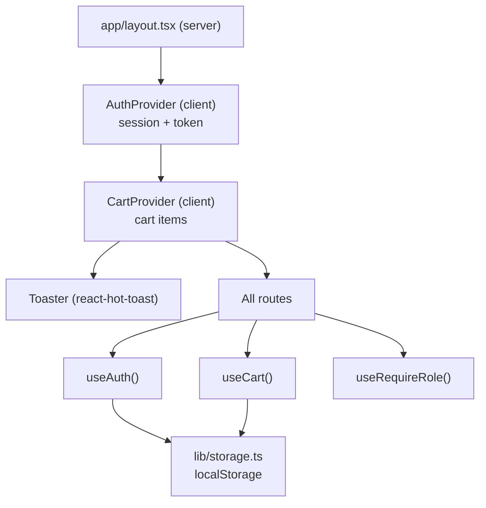

# Design — Checkpoint 3: RevoShop Auth, Cart and Admin

## Overview

Checkpoint 3 turns the read-only storefront from Checkpoint 2 into a full application: authentication with persisted sessions, a `localStorage`-backed cart, checkout that writes a real order, role-gated routes, admin CRUD for products and categories, toast feedback, and a Playwright suite covering the three graded journeys.

Guiding constraints:

- **Two client-side contexts own mutable session state.** `AuthProvider` and `CartProvider` are the only places session and cart live. Everything else reads them through hooks.
- **Writes are authenticated from the browser, not the server.** Checkpoint 2's orders route logged in server-side with demo credentials because there was no real user session. That is now replaced: the logged-in user's own token drives every write, and the server-only demo-login path is retired.
- **The API is the authority on permissions.** Role checks in the UI are for routing and affordances only. The backend independently enforces admin-only writes and order ownership, verified by probe.
- **Local only.** No Vercel deployment this checkpoint.

### Verified API contract

Every line below was confirmed against the live API before this design was written. The backend changed since Checkpoint 2 — registration moved — so this supersedes the Checkpoint 2 contract.

| Request | Auth | Result |
|---|---|---|
| `POST /register` | none | 201 with the user object. Body `{username, email, password}`. Password minimum 8 characters |
| `POST /auth/login` | none | 200 with `{access_token, refresh_token, expires_in, refresh_expires_in, token_type, user}` |
| `GET /products`, `/products/:id`, `/categories` | none | 200, public reads (unchanged from Checkpoint 2) |
| `POST /products`, `PUT /products/:id`, `DELETE /products/:id` | admin | 401 unauthenticated; **403 `admin_required`** with a customer token |
| `POST /categories`, `PUT /categories/:id`, `DELETE /categories/:id` | admin | same as products |
| `POST /orders` | any logged-in | 201. Body `{items: [{product_id, quantity}]}`. User taken from the token |
| `GET /orders` | any logged-in | the caller's own orders only |
| `GET /orders?user_id=N` | owner or admin | 200 for the owner; admin may query **any** user; customer requesting another user gets 403 |
| `GET /orders?all=true` | **admin only** | 200 with every order across all users. Customer gets **403 `admin_required`** |
| `GET /orders/:id` | owner or admin | 200 with nested `items[]`, each `{product, quantity, unit_price}` |

Four consequences that shape the design:

1. **Registration cannot create an admin.** `POST /register` silently ignores a `role` field and always returns `CUSTOMER`. The admin account used for development and testing was created out of band. Nothing in the UI offers role selection.
2. **`?all=true` is the admin order overview.** There is no `/admin/orders` route and no user-list endpoint (`GET /users` is 404), so enumerating users is impossible. `?all=true` is the only way to satisfy the cross-user overview, and it is correctly admin-gated.
3. **Deletion guards are backend-enforced.** The frontend does not re-implement them. It attempts the delete and surfaces the API's own refusal message, which keeps one source of truth.
4. **Order status is a wider union than Checkpoint 2 assumed.** Live data contains `PENDING`, `PROCESSING`, `SHIPPED`, `COMPLETED`, and `CANCELLED`.

### Security posture

Confirmed by probe rather than assumed:

- A customer token on any product or category write returns 403 `admin_required`.
- A customer token on `GET /orders?all=true` returns 403 `admin_required`.
- A customer token requesting another user's orders returns 403.

So the UI's role gating is a usability layer. A customer who bypasses the client-side redirect still cannot perform an admin action, because the server refuses it. This is the correct arrangement and worth stating explicitly: client-side route guards are never a security boundary on their own.

**The access token is held in `localStorage`.** This is what the checkpoint asks for (`localStorage` session persistence is a named requirement) and is standard for this kind of exercise, but it is readable by any script on the page, so it is vulnerable to XSS in a way an `HttpOnly` cookie would not be. Mitigation within scope: every value interpolated into the DOM is escaped by React by default, and no `dangerouslySetInnerHTML` is introduced. Recorded here so the tradeoff is deliberate rather than accidental.

## Architecture

### Directory layout

Requirement 12 asks for pages, components, hooks, context, and lib separated. Two directories are new.

```
module-3-alzedmkrom/
├─ app/
│  ├─ layout.tsx                  # + AuthProvider, CartProvider, Toaster
│  ├─ page.tsx                     # home (Checkpoint 2)
│  ├─ products/…                   # listing + detail (Checkpoint 2) + AddToCartButton
│  ├─ categories/…                 # listing (Checkpoint 2)
│  ├─ login/page.tsx               # NEW
│  ├─ register/page.tsx            # NEW
│  ├─ cart/page.tsx                # NEW
│  ├─ checkout/page.tsx            # NEW
│  ├─ orders/
│  │  ├─ page.tsx                  # REWORKED: own orders via user session
│  │  └─ [id]/page.tsx             # NEW: order detail with line items
│  └─ dashboard/
│     ├─ layout.tsx                # NEW: admin gate for the whole segment
│     ├─ page.tsx                  # NEW: product CRUD
│     ├─ categories/page.tsx       # NEW: category CRUD
│     └─ orders/page.tsx           # NEW: read-only all-user overview
├─ components/                     # existing + the new forms and tables
├─ context/                        # NEW
│  ├─ AuthContext.tsx
│  └─ CartContext.tsx
├─ hooks/                          # NEW
│  ├─ useAuth.ts
│  ├─ useCart.ts
│  └─ useRequireRole.ts
├─ lib/
│  ├─ types.ts                     # + User, Session, CartItem, wider OrderStatus
│  ├─ api.ts                       # + authenticated write helpers
│  ├─ storage.ts                   # NEW: typed, SSR-safe localStorage access
│  └─ auth.ts                      # RETIRED (server-side demo login removed)
├─ e2e/                            # NEW: Playwright specs
├─ playwright.config.ts            # NEW
└─ .env.example / .env.local        # + test credentials
```

### State ownership



`AuthProvider` wraps `CartProvider` because clearing the cart on logout needs the auth event, not the reverse.

### Why the Checkpoint 2 orders path is replaced

Checkpoint 2 read orders in a Server Component that logged in server-side with `DEMO_USER_EMAIL` / `DEMO_USER_PASSWORD`, because there was no user session to borrow a token from. That was a deliberate stopgap and it is now wrong: orders must belong to the *logged-in* user.

So `/orders` becomes a Client Component reading the session token, and `lib/auth.ts` plus the `DEMO_USER_*` variables are retired. The `connection()` call and the `Suspense` wrapper that existed only to defer that server-side login go with it.

This is a real behavioural change, not a refactor: before, `/orders` always showed user 14's orders; now it shows whoever is logged in.

## Data Models

Additions to `lib/types.ts`. Existing `Product`, `Category`, `Order`, and `OrderDetail` shapes carry over.

```ts
// ---------- auth ----------

export type Role = 'CUSTOMER' | 'ADMIN';

// The user object returned inside the login response and by POST /register.
export interface UserRecord {
  id: number;
  username: string;
  email: string;
  role: Role;
  is_active: boolean;
  created_at: string;
}

export interface User {
  id: number;
  username: string;
  email: string;
  role: Role;
  isActive: boolean;
  createdAt: string;
}

// What POST /auth/login returns. refresh_token is captured but unused:
// token refresh is beyond this checkpoint's scope.
export interface LoginResponse {
  access_token: string;
  expires_in: number;
  token_type: string;
  user: UserRecord;
}

// The persisted session. Written to localStorage under one key so a partial
// write can never leave a token without its user.
export interface Session {
  token: string;
  user: User;
  expiresAt: number;   // absolute epoch ms, derived from expires_in
}

// ---------- cart ----------

// A cart line stores the quantity plus a snapshot of the fields needed to
// render and total the row without refetching. Price is snapshotted so the
// cart total cannot silently change if an admin edits the product mid-session;
// checkout sends only product_id and quantity, so the API reprices server-side.
export interface CartItem {
  productId: number;
  name: string;
  price: number;
  quantity: number;
  stockQuantity: number;
}

// ---------- orders ----------

// Widened from Checkpoint 2: live data contains all five of these.
export type OrderStatus =
  | 'PENDING'
  | 'PROCESSING'
  | 'SHIPPED'
  | 'COMPLETED'
  | 'CANCELLED'
  | (string & {});

// ---------- forms ----------

export interface RegisterFormState {
  username: string;
  email: string;
  password: string;
}

export interface LoginFormState {
  email: string;
  password: string;
}

export interface ProductFormState {
  name: string;
  description: string;
  price: string;
  stockQuantity: string;
  categoryId: string;
}

export interface CategoryFormState {
  name: string;
  description: string;
}

export type FormErrors<T> = Partial<Record<keyof T, string>>;
```

### Storage keys

```ts
export const SESSION_KEY = 'revoshop.session';
export const CART_KEY = 'revoshop.cart';
```

Namespaced so they cannot collide with anything else on `localhost`.

## Components and Interfaces

### SSR-safe storage (`lib/storage.ts`)

`localStorage` does not exist during server rendering, so every access is guarded. Reads also validate shape, because a stale or hand-edited value must not crash the app.

```ts
export function readJson<T>(key: string, isValid: (value: unknown) => value is T): T | null {
  if (typeof window === 'undefined') return null;
  try {
    const raw = window.localStorage.getItem(key);
    if (raw === null) return null;
    const parsed: unknown = JSON.parse(raw);
    return isValid(parsed) ? parsed : null;
  } catch {
    return null;   // malformed JSON or storage blocked
  }
}
```

A type guard is required rather than a bare cast: `JSON.parse` returns `any`, and trusting it would let a corrupted session propagate as a valid `Session`.

### AuthProvider (`context/AuthContext.tsx`)

A Client Component holding `session: Session | null`.

| Member | Behaviour |
|---|---|
| `session` | current session, or `null` when logged out |
| `user` | `session?.user ?? null` |
| `isLoading` | `true` until the first `localStorage` read completes |
| `login(email, password)` | `POST /auth/login`, persist, return the user so the caller can route by role |
| `register(username, email, password)` | `POST /register`, then log in with the same credentials |
| `logout()` | clear session and cart storage, reset state |

Two details that matter:

- **Hydration.** The session is read in a `useEffect`, not during render, so the server and first client render agree. `isLoading` covers that first tick; route guards must wait for it rather than redirecting a user who is actually logged in.
- **Registration does not return a token.** `POST /register` returns only the user object, so `register` chains into `login` to obtain one. If the follow-up login fails, the account exists but the user is not logged in, and the surfaced message says so rather than implying registration failed.

### CartProvider (`context/CartContext.tsx`)

Holds `items: CartItem[]`, mirrored to `localStorage` on every change.

| Member | Behaviour |
|---|---|
| `items` | current cart lines |
| `addItem(product, quantity)` | add, or increase an existing line, clamped to `stockQuantity` |
| `removeItem(productId)` | drop that line |
| `clear()` | empty the cart and its storage |
| `totalItems` / `totalPrice` | derived with `reduce` on every render |
| `isEmpty` | `items.length === 0` |

Every update returns a new array — no `push` or index assignment — so React sees a fresh reference and the totals recompute. Totals are derived, never stored, so they cannot drift from the lines.

### Route protection (`hooks/useRequireRole.ts`)

```ts
useRequireRole();            // any logged-in user
useRequireRole('ADMIN');     // admin only
```

Behaviour: while `isLoading`, render nothing and do not redirect. Once resolved, a logged-out user goes to `/login`, and a wrong-role user goes to `/`. The hook returns a `ready` flag so the page renders its content only when authorized.

Requirement 4.6 — no flash of protected content — follows from gating on `ready` rather than rendering first and redirecting after.

The admin gate lives in `app/dashboard/layout.tsx`, so all three dashboard routes inherit it from one place instead of repeating the check.

### Authenticated requests (`lib/api.ts`)

Checkpoint 2's `fetchJson` already checks `res.ok` before parsing and throws a typed `ApiError`. That stays. Added:

```ts
async function authedFetchJson<T>(path: string, token: string, init?: RequestInit): Promise<T>
```

It sets `Authorization: Bearer <token>` and `Content-Type: application/json`. New helpers, each taking the caller's token:

| Helper | Request |
|---|---|
| `createProduct`, `updateProduct`, `deleteProduct` | `POST` / `PUT` / `DELETE /products[/:id]` |
| `createCategory`, `updateCategory`, `deleteCategory` | `POST` / `PUT` / `DELETE /categories[/:id]` |
| `createOrder(items)` | `POST /orders` |
| `getMyOrders()` | `GET /orders` |
| `getOrderDetail(id)` | `GET /orders/:id` |
| `getAllOrders()` | `GET /orders?all=true` — admin only |

The app model is camelCase, the wire is snake_case, so write helpers map outbound too: `stockQuantity` becomes `stock_quantity`, `categoryId` becomes `category_id`. The existing `toProduct` family handles inbound.

**Error surfacing.** `ApiError` already carries the API's `message`. The deletion guards are backend-enforced, so the UI shows `error.message` verbatim — that is how the required "visible error when deleting a product with active orders" appears without the frontend duplicating the rule.

### Forms

All forms share one shape: controlled inputs bound to a typed `FormState`, a pure `validate(state): FormErrors<State>` function, `preventDefault()` first on submit, per-field messages below each input wired with `aria-describedby` and `aria-invalid`, values preserved on failure, and a submit button disabled while the request is in flight.

| Form | Validation |
|---|---|
| `RegisterForm` | username non-empty; email matches a basic address shape; password at least 8 characters, matching the API's rule |
| `LoginForm` | both fields non-empty; invalid credentials surface the API message inline |
| `CreateProductForm` / `EditProductForm` | name non-empty; price a positive number; stock a non-negative integer; category selected |
| `CreateCategoryForm` | name non-empty (Requirement 9.2 names this specifically) |

Client-side validation is for feedback speed only. The server validates independently, and its message wins when the two disagree.

### Toasts

`react-hot-toast`, with a single `<Toaster />` in the root layout. One helper keeps the message style uniform:

```ts
toastSuccess('Product created');
toastError(error);   // reads ApiError.message, falls back to a generic line
```

`toastError` takes the error object rather than a string so no call site has to decide how to unwrap an `ApiError`.

### Pages

**`/login`, `/register`** — forms, then route by role: `ADMIN` to `/dashboard`, `CUSTOMER` to `/`. A logged-in visitor is redirected away from both.

**`AddToCartButton`** — client component on product cards and the detail page. Adds to the cart and toasts. Disabled when the product is out of stock. Adding does not require login, so a visitor can fill a cart; checkout is what requires a session.

**`/cart`** — table of rows (product, unit price, quantity, line total, remove), an overall total, an empty state, and a checkout button disabled when empty. Protected by `useRequireRole()`.

**`/checkout`** — order summary and a confirm button. On confirm: `createOrder` with `{product_id, quantity}` pairs, then clear the cart and redirect to `/orders`. On failure the cart is left intact and the error is toasted. The confirm button is disabled while submitting, so a double-click cannot create two orders.

**`/orders`** — the logged-in user's own orders via `getMyOrders()`. Each row links to its detail page.

**`/orders/[id]`** — one order with its line items, reusing the Checkpoint 2 expand markup but fetching with the user's own token.

**`/dashboard`** — product table plus create, edit, and delete. Create and edit render in a form panel; delete asks for confirmation first, since it is destructive and may be refused by the guard.

**`/dashboard/categories`** — the same pattern for categories.

**`/dashboard/orders`** — read-only table from `getAllOrders()`, showing id, user id, status, total, and date. No mutation controls.

## Correctness Properties

### Property 1: Client-side role gating is not the security boundary

**Validates: Requirements 4.3, 4.4, 8.6**

Bypassing a UI redirect does not grant an admin action. Every product and category write is independently rejected by the API with 403 `admin_required` for a non-admin token, verified by probe.

### Property 2: No flash of protected content

**Validates: Requirement 4.6**

A protected page renders its content only when `useRequireRole` reports `ready`. While the session is still being read from storage, nothing protected is painted and no redirect fires.

### Property 3: Session survives refresh

**Validates: Requirements 3.1, 3.2, 3.3**

After login, a full reload restores the same user and the header still shows the username, because the session is read from `localStorage` on mount rather than held only in memory.

### Property 4: Cart survives refresh and is never mutated in place

**Validates: Requirements 5.2, 5.7**

Every cart operation produces a new array, and the result is mirrored to `localStorage`. A reload restores the same lines.

### Property 5: Cart totals are derived, never accumulated

**Validates: Requirement 5.4**

`totalItems` and `totalPrice` are recomputed from `items` on each render, so they cannot drift from the rows on screen.

### Property 6: Checkout is atomic from the user's perspective

**Validates: Requirements 6.3, 6.4**

The cart is cleared only after the API accepts the order. A failed checkout leaves the cart exactly as it was, so nothing is lost and the user can retry.

### Property 7: Checkout cannot double-submit

**Validates: Requirement 6.2**

The confirm button is disabled while the request is in flight, so one confirmation creates exactly one order.

### Property 8: Empty cart cannot reach checkout

**Validates: Requirements 5.5, 6.5**

With no items, the checkout button is disabled and the confirm action is unavailable.

### Property 9: Deletion guards are surfaced, not reimplemented

**Validates: Requirements 8.5, 9.4**

The frontend attempts the delete and displays the API's refusal message. There is no second copy of the guard rule in the client, so the two can never disagree.

### Property 10: Orders shown belong to the logged-in user

**Validates: Requirements 7.1, 7.3**

`/orders` and `/orders/[id]` fetch with the session token and request no other user's data. The server independently refuses cross-user reads for customers.

### Property 11: The admin overview is the only cross-user read

**Validates: Requirements 10.1, 10.2**

`/dashboard/orders` uses `?all=true`, which the API restricts to admins. A customer calling it receives 403, verified by probe.

### Property 12: No secret reaches the repository

**Validates: Requirements 15.1, 15.2, 15.3, 15.4**

Credentials live only in git-ignored `.env.local`. The committed `.env.example` holds placeholders. No password appears in source, tests, or documentation; Playwright reads credentials from the environment.

### Property 13: Storage reads cannot crash the app

**Validates: Requirements 3.6, 5.2**

Malformed or foreign `localStorage` values are rejected by a type guard and treated as absent, so a corrupted entry logs the user out rather than throwing during render.

### Property 14: Tests are repeatable

**Validates: Requirement 13.6**

Each Playwright run registers a uniquely generated email and creates uniquely named records, so a second run does not collide with the first on the API's uniqueness rules.

## Error Handling

| Case | Handling |
|---|---|
| Invalid login | API message rendered inline on the form, no redirect, values preserved |
| Duplicate email on register | API message surfaced; the form stays filled |
| Registration succeeds but follow-up login fails | Message states the account exists and asks the user to log in |
| Any non-2xx write | `ApiError` with status and the API's message, shown as an error toast |
| Delete refused by a guard | The API's explanation shown verbatim, inline on the dashboard and as a toast |
| Expired or rejected token (401) | Session cleared, user sent to `/login` with an explanatory toast |
| Out-of-stock add to cart | Control disabled; quantity clamped to available stock |
| Checkout with an empty cart | Unreachable by design — control disabled |
| Network failure | Caught, toasted, local state untouched |
| Corrupted `localStorage` | Type guard rejects it; treated as logged out / empty cart |

## Testing Strategy

**Automated gates:** `npx tsc --noEmit`, `npm run lint`, and `npm run build` must all exit 0.

**Playwright** (`e2e/`), run against the local dev server. `playwright.config.ts` sets `baseURL` to `http://localhost:3000` and uses `webServer` so the suite can start the app itself.

Three specs, matching the three graded journeys:

| Spec | Covers |
|---|---|
| `auth.spec.ts` | Register a fresh user, assert the redirect and the username in the header, reload to prove persistence, log out, log back in, and assert an error on bad credentials |
| `shop.spec.ts` | Browse the products list, add to cart, assert the cart table and total, check out, assert the cart cleared and the redirect to `/orders`, and assert the new order appears |
| `admin.spec.ts` | Log in as admin, create a product and assert it in the table, edit it and assert the change, delete it and assert removal, then the same create/edit/delete cycle for a category |

Test data rules:

- Registration uses a unique email per run, e.g. `e2e-${Date.now()}@example.test`.
- Admin CRUD creates records with a run-scoped name prefix and deletes what it creates, so the suite is self-cleaning and leaves no litter in the shared database.
- Credentials come from `E2E_ADMIN_EMAIL` and `E2E_ADMIN_PASSWORD`; the suite fails with a clear message when they are unset rather than silently skipping.
- Assertions target user-visible text and roles rather than CSS classes, so styling changes do not break tests.

**Manual checks** that automation covers poorly: the no-flash behaviour on protected routes, toast appearance and wording, and the guard error when deleting a product that has active orders (depends on shared data the suite should not create).

## Environment configuration

`.env.example`, committed with placeholders:

```
# Public
NEXT_PUBLIC_API_BASE_URL=https://web-production-03650.up.railway.app

# Playwright only — never real user credentials in source
E2E_ADMIN_EMAIL=replace-me@example.com
E2E_ADMIN_PASSWORD=replace-me
```

Retired from Checkpoint 2: `DEMO_USER_EMAIL`, `DEMO_USER_PASSWORD`, `DEMO_USER_ID`, and `API_SECRET_KEY`. The first three existed only for the server-side orders login that this checkpoint replaces with a real session. `API_SECRET_KEY` was declared for the Checkpoint 2 rubric and never used by any request; keeping an unused secret invites confusion, so it goes.

## Commit plan

_Requirement 12.3 — history across forms, authentication, and testing._

| # | Scope | Message |
|---|---|---|
| 1 | deps + types | `chore: add react-hot-toast and playwright, extend types for auth and cart` |
| 2 | storage + api | `feat(lib): add SSR-safe storage and authenticated API helpers` |
| 3 | auth context | `feat(auth): add AuthProvider, useAuth and session persistence` |
| 4 | auth pages | `feat(auth): add register and login pages with validated forms` |
| 5 | header | `feat(auth): show username and logout in the header` |
| 6 | guards | `feat(auth): add role-based route protection` |
| 7 | cart state | `feat(cart): add CartProvider with localStorage persistence` |
| 8 | cart page | `feat(cart): add AddToCartButton and cart page with totals` |
| 9 | checkout | `feat(cart): add checkout that creates an order and clears the cart` |
| 10 | orders | `feat(orders): show the logged-in user's orders and order detail` |
| 11 | product CRUD | `feat(dashboard): add product CRUD with deletion guard errors` |
| 12 | category CRUD | `feat(dashboard): add category CRUD with deletion guard errors` |
| 13 | admin orders | `feat(dashboard): add read-only all-user order overview` |
| 14 | toasts | `feat(ui): add toast notifications for cart and CRUD actions` |
| 15 | e2e auth | `test(e2e): cover registration and login flow` |
| 16 | e2e shop | `test(e2e): cover browse, add to cart and checkout journey` |
| 17 | e2e admin | `test(e2e): cover admin CRUD dashboard journey` |
| 18 | docs | `docs: document features, setup, testing and screenshots` |

## Requirements traceability

| Requirement | Satisfied by |
|---|---|
| 1.1 – 1.6 | `/register`, `RegisterForm`, `AuthProvider.register` via `POST /register` |
| 2.1 – 2.4 | `/login`, `LoginForm`, `AuthProvider.login` |
| 3.1 – 3.6 | `lib/storage.ts`, `AuthProvider` mount read, `Header` username and logout |
| 4.1 – 4.6 | `useRequireRole`, `app/dashboard/layout.tsx`, role routing after auth |
| 5.1 – 5.7 | `AddToCartButton`, `CartProvider`, `/cart` table and empty state |
| 6.1 – 6.5 | `/checkout`, `createOrder`, cart clear and redirect |
| 7.1 – 7.4 | `/orders`, `/orders/[id]` with the session token |
| 8.1 – 8.6 | `/dashboard`, product forms, `ApiError.message` for guards |
| 9.1 – 9.4 | `/dashboard/categories`, `CreateCategoryForm` |
| 10.1 – 10.3 | `/dashboard/orders` via `?all=true` |
| 11.1 – 11.4 | `react-hot-toast`, `Toaster` in the root layout, `toastSuccess` / `toastError` |
| 12.1 – 12.4 | `context/`, `hooks/`, `lib/`, `components/`, `app/`; commit plan; build gates |
| 13.1 – 13.7 | `playwright.config.ts`, `e2e/auth.spec.ts`, `shop.spec.ts`, `admin.spec.ts` |
| 14.1 – 14.5 | README sections and screenshots |
| 15.1 – 15.4 | `.env.example` placeholders, git-ignored `.env.local`, env-sourced test credentials |
