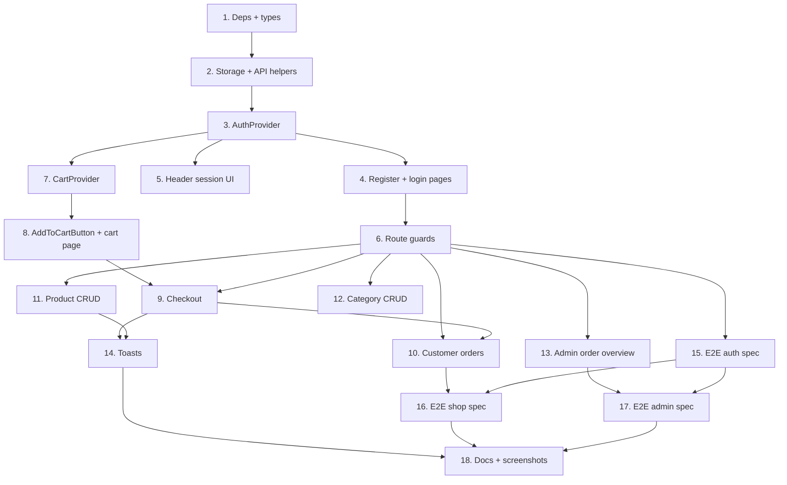

# Implementation Plan

## Overview

Eighteen commits in dependency order: dependencies and types, then the data and storage layer, then authentication, then the cart and checkout, then the admin dashboard, then toasts, then the three Playwright suites, then documentation.

The assignment's tip — "build one auth/data flow at a time" — shapes the ordering: registration, login and session persistence land completely (tasks 3 through 6) before any cart work begins. The second tip — "write a Playwright test for a flow right after you build it" — is why tasks 15 through 17 each sit immediately after the feature they cover is finished, rather than all tests being deferred to the end.

Every endpoint, status code and response shape referenced below was verified against the live API while writing the design, so no contract here is assumed.

## Task Dependency Graph

```json
{
  "waves": [
    { "wave": 1, "tasks": ["1"], "dependsOn": [] },
    { "wave": 2, "tasks": ["2"], "dependsOn": ["1"] },
    { "wave": 3, "tasks": ["3"], "dependsOn": ["2"] },
    { "wave": 4, "tasks": ["4", "5"], "dependsOn": ["3"] },
    { "wave": 5, "tasks": ["6"], "dependsOn": ["4"] },
    { "wave": 6, "tasks": ["7"], "dependsOn": ["3"] },
    { "wave": 7, "tasks": ["8"], "dependsOn": ["7"] },
    { "wave": 8, "tasks": ["9"], "dependsOn": ["8", "6"] },
    { "wave": 9, "tasks": ["10"], "dependsOn": ["6", "9"] },
    { "wave": 10, "tasks": ["11", "12", "13"], "dependsOn": ["6"] },
    { "wave": 11, "tasks": ["14"], "dependsOn": ["9", "11", "12"] },
    { "wave": 12, "tasks": ["15"], "dependsOn": ["6"] },
    { "wave": 13, "tasks": ["16"], "dependsOn": ["10", "15"] },
    { "wave": 14, "tasks": ["17"], "dependsOn": ["13", "15"] },
    { "wave": 15, "tasks": ["18"], "dependsOn": ["14", "16", "17"] }
  ]
}
```



Tasks 1 through 3 are strictly sequential — everything needs types, then storage, then the auth context. After the guards land (task 6), the three admin routes (11, 12, 13) are independent of the cart chain (7, 8, 9) and can proceed in either order.

## Tasks

- [x] 1. Add dependencies and extend the type layer
- [x] 1.1 Install the new dependencies
  - Install `react-hot-toast` as a dependency and `@playwright/test` as a dev dependency, pinning exact versions
  - Run `npx playwright install` to fetch the browser binaries
  - Rename the `package.json` `name` field from `next-scaffold` to `revoshop`, a leftover from the Checkpoint 2 temp-directory scaffold
  - Add a `test:e2e` script running `playwright test`
  - _Requirements: 13.1_

- [x] 1.2 Extend `lib/types.ts`
  - Add `Role`, `UserRecord`, `User`, `LoginResponse` and `Session`
  - Add `CartItem` carrying `productId`, `name`, `price`, `quantity` and `stockQuantity`
  - Widen `OrderStatus` to include `PROCESSING`, `SHIPPED`, `COMPLETED` and `CANCELLED`; live data contains all five states, not just `PENDING`
  - Add `RegisterFormState`, `LoginFormState`, `ProductFormState`, `CategoryFormState` and the generic `FormErrors<T>`
  - Add a `toUser` mapper from the snake_case `UserRecord` to the camelCase `User`
  - Export `SESSION_KEY` and `CART_KEY` as namespaced storage keys
  - Commit: `chore: add react-hot-toast and playwright, extend types for auth and cart`
  - _Requirements: 12.1_

- [x] 2. Build the storage and authenticated request layer
- [x] 2.1 Write `lib/storage.ts`
  - Implement `readJson<T>(key, isValid)` that returns `null` during server rendering, on missing keys, on malformed JSON, and when the value fails its type guard
  - Implement `writeJson(key, value)` and `remove(key)`, both no-ops when `window` is undefined
  - Write type guards `isSession` and `isCartItemArray`; a bare cast is not acceptable because `JSON.parse` returns `any` and a corrupted entry must not propagate as valid state
  - _Requirements: 3.1, 3.6_

- [x] 2.2 Add authenticated helpers to `lib/api.ts`
  - Add `authedFetchJson<T>(path, token, init)` setting `Authorization: Bearer <token>` and the JSON content type, reusing the existing `res.ok` check and `ApiError`
  - Add `register(username, email, password)` targeting `POST /register` — note the endpoint moved from `POST /users`, which now returns 404
  - Add `login(email, password)` targeting `POST /auth/login`, reading `access_token`, `expires_in` and `user`
  - Add `createProduct`, `updateProduct`, `deleteProduct`, `createCategory`, `updateCategory`, `deleteCategory`, each taking the caller's token
  - Add `createOrder(items, token)` posting `{items: [{product_id, quantity}]}`
  - Add `getMyOrders(token)`, `getOrderDetail(id, token)` and `getAllOrders(token)`; the last targets `GET /orders?all=true`, which the API restricts to admins
  - Map outbound camelCase to snake_case in the write helpers: `stockQuantity` to `stock_quantity`, `categoryId` to `category_id`
  - Commit: `feat(lib): add SSR-safe storage and authenticated API helpers`
  - _Requirements: 1.6, 15.1_

- [x] 3. Build the auth context
  - Create `context/AuthContext.tsx` as a client component holding `session: Session | null`
  - Read the persisted session inside a `useEffect`, not during render, so the server and first client render agree; expose `isLoading` true until that read completes
  - Implement `login(email, password)` that persists the session and returns the user, so callers can route by role
  - Implement `register(username, email, password)` that calls `POST /register` then chains into `login`, because registration returns only the user object and no token
  - IF the follow-up login fails THEN report that the account was created but the sign-in did not succeed, rather than implying registration failed
  - Implement `logout()` clearing both the session and the cart storage
  - Create `hooks/useAuth.ts` throwing a clear error when used outside the provider
  - Mount `AuthProvider` in `app/layout.tsx`, wrapping `CartProvider` (added in task 7) so logout can clear the cart
  - Commit: `feat(auth): add AuthProvider, useAuth and session persistence`
  - _Requirements: 1.4, 2.4, 3.1, 3.2, 3.6_

- [x] 4. Build the register and login pages
- [x] 4.1 Build `RegisterForm` and the `/register` route
  - Controlled inputs for username, email and password bound to `RegisterFormState`
  - Write `validate(state): FormErrors<RegisterFormState>` rejecting an empty username, a malformed email, and a password under 8 characters to match the API's rule
  - Call `preventDefault()` first on submit, validate, and submit only when no errors are returned
  - Render each message below its own input, wired with `aria-describedby` and `aria-invalid`; preserve entered values on failure
  - Disable the submit control while the request is in flight
  - On success route by role: `ADMIN` to `/dashboard`, `CUSTOMER` to `/`
  - Surface the API's message on failure, for example a duplicate email
  - _Requirements: 1.1, 1.2, 1.3, 1.4, 1.5, 4.1, 4.2_

- [x] 4.2 Build `LoginForm` and the `/login` route
  - Controlled email and password inputs with both-non-empty validation
  - On success route by role, exactly as registration does
  - IF credentials are invalid THEN render the API's error message inline AND perform no redirect
  - Redirect an already-logged-in visitor away from both `/login` and `/register`
  - Commit: `feat(auth): add register and login pages with validated forms`
  - _Requirements: 2.1, 2.2, 2.3, 4.1, 4.2_

- [x] 5. Show session state in the header
  - Read the session through `useAuth()` in a client component inside `Header`
  - WHILE a user is logged in, display the username AND a logout control
  - WHILE no user is logged in, display login and register links instead
  - Verify the username survives a full page refresh, which is what proves the session is restored from storage rather than held only in memory
  - Avoid a hydration mismatch: render the logged-out affordances until `isLoading` resolves
  - Commit: `feat(auth): show username and logout in the header`
  - _Requirements: 3.3, 3.4, 3.5_

- [x] 6. Add role-based route protection
  - Create `hooks/useRequireRole.ts` accepting an optional required role and returning a `ready` flag
  - WHILE `isLoading` is true, neither redirect nor report ready, so a logged-in user is never bounced during the storage read
  - WHEN no user is logged in THEN redirect to `/login`
  - WHEN the user's role does not match the requirement THEN redirect to `/`
  - Create `app/dashboard/layout.tsx` applying `useRequireRole('ADMIN')` so all three dashboard routes inherit one gate
  - Gate `/cart`, `/checkout`, `/orders` and `/orders/[id]` on a logged-in user
  - Render protected content only when `ready` is true, so no protected markup paints before a redirect
  - Note in a comment that this is a usability layer, not a security boundary: the API independently returns 403 `admin_required` for a non-admin write
  - Commit: `feat(auth): add role-based route protection`
  - _Requirements: 4.3, 4.4, 4.5, 4.6_

- [x] 7. Build the cart context
  - Create `context/CartContext.tsx` holding `items: CartItem[]`, mirrored to `localStorage` on every change
  - Implement `addItem(product, quantity)` adding a line or increasing an existing one, clamped to the product's `stockQuantity`
  - Implement `removeItem(productId)` and `clear()`
  - Derive `totalItems`, `totalPrice` and `isEmpty` with `reduce` on every render rather than storing them, so they cannot drift from the lines
  - Return a new array from every update; no `push`, `splice` or index assignment on state
  - Read the persisted cart in a `useEffect` using the `isCartItemArray` guard
  - Create `hooks/useCart.ts`; mount `CartProvider` inside `AuthProvider`
  - Commit: `feat(cart): add CartProvider with localStorage persistence`
  - _Requirements: 5.2, 5.7_

- [x] 8. Build the add-to-cart control and cart page
- [x] 8.1 Build `AddToCartButton`
  - Client component calling `useCart().addItem`
  - Disable it when the product is out of stock
  - Place it on the product cards and the product detail page
  - Adding does not require a session; checkout is the gate, so a visitor can fill a cart before logging in
  - _Requirements: 5.1_

- [x] 8.2 Build the `/cart` route
  - Render a table with one row per item showing the product, unit price, quantity and line total, plus a remove button per row
  - Show the overall total beneath the table
  - WHEN the cart is empty THEN render an empty state AND disable the checkout button
  - Verify a page refresh restores the same cart contents
  - Commit: `feat(cart): add AddToCartButton and cart page with totals`
  - _Requirements: 5.3, 5.4, 5.5, 5.6_

- [x] 9. Build checkout
  - Create `/checkout` rendering the order summary and a confirm control, gated on a logged-in user
  - WHEN confirmed THEN call `createOrder` with the cart's `{product_id, quantity}` pairs using the session token
  - WHEN the API accepts the order THEN clear the cart from state and storage AND redirect to `/orders`
  - IF the request fails THEN leave the cart intact AND surface the failure, so nothing is lost and the user can retry
  - Disable the confirm control while the request is in flight, so one confirmation cannot create two orders
  - Keep the confirm action unavailable when the cart is empty
  - Commit: `feat(cart): add checkout that creates an order and clears the cart`
  - _Requirements: 6.1, 6.2, 6.3, 6.4, 6.5_

- [x] 10. Rework the customer order views
  - Convert `/orders` to read the logged-in user's orders with `getMyOrders(token)`
  - Create `/orders/[id]` showing one order with its line items, each with product, quantity and unit price
  - Render an empty state when the user has no orders
  - Remove the Checkpoint 2 server-side demo login: delete `lib/auth.ts`, the `connection()` call and the `Suspense` wrapper that existed only to defer it, and drop `DEMO_USER_EMAIL`, `DEMO_USER_PASSWORD`, `DEMO_USER_ID` and `API_SECRET_KEY` from both env files
  - This is a behavioural change, not a refactor: the route previously always showed user 14's orders and must now show the session user's
  - Commit: `feat(orders): show the logged-in user's orders and order detail`
  - _Requirements: 7.1, 7.2, 7.3, 7.4_

- [x] 11. Build admin product CRUD
  - Create `/dashboard` rendering the product table with create, edit and delete controls
  - Build `CreateProductForm` with controlled inputs and a `validate` pass: name non-empty, price a positive number, stock a non-negative integer, category selected
  - Verify a created product appears in the product table
  - Build `EditProductForm` pre-filled from the selected product; verify the table reflects the update
  - Ask for confirmation before deleting, since deletion is destructive and may be refused
  - WHEN the API refuses a delete because the product has active orders THEN display its message verbatim, inline and as a toast; do not reimplement the guard, since the backend owns that rule
  - Commit: `feat(dashboard): add product CRUD with deletion guard errors`
  - _Requirements: 8.1, 8.2, 8.3, 8.4, 8.5, 8.6_

- [x] 12. Build admin category CRUD
  - Create `/dashboard/categories` with the category list and create, edit and delete controls
  - Build `CreateCategoryForm` validating that the name field is non-empty
  - Implement edit and delete against the category endpoints
  - WHEN the API refuses a delete because products are still linked THEN display its message verbatim
  - Commit: `feat(dashboard): add category CRUD with deletion guard errors`
  - _Requirements: 9.1, 9.2, 9.3, 9.4_

- [x] 13. Build the admin order overview
  - Create `/dashboard/orders` fetching `getAllOrders(token)`, which targets `GET /orders?all=true`
  - Render a read-only table of id, user id, status, total and date, with no mutation controls
  - Rely on the inherited admin gate from the dashboard layout; a customer calling this endpoint receives 403 `admin_required` from the API regardless
  - Commit: `feat(dashboard): add read-only all-user order overview`
  - _Requirements: 10.1, 10.2, 10.3_

- [x] 14. Add toast notifications
  - Mount a single `<Toaster />` in the root layout
  - Write `toastSuccess(message)` and `toastError(error)` helpers; the error helper accepts the error object and unwraps `ApiError.message`, so no call site decides how to format a failure
  - Fire a success toast on add to cart, remove from cart, checkout, and every create, update and delete
  - Fire an error toast on every failed cart action and failed CRUD operation
  - Keep the text descriptive of what happened rather than printing a raw error object
  - Commit: `feat(ui): add toast notifications for cart and CRUD actions`
  - _Requirements: 11.1, 11.2, 11.3, 11.4_

- [x] 15. Write the authentication end-to-end spec
  - Create `playwright.config.ts` with `baseURL` set to `http://localhost:3000` and a `webServer` entry so the suite can start the app itself
  - Fail with a clear message when `E2E_ADMIN_EMAIL` or `E2E_ADMIN_PASSWORD` is unset, rather than skipping silently
  - Create `e2e/auth.spec.ts` registering a user with a unique email per run, for example `e2e-${Date.now()}@example.test`, since the API rejects duplicates
  - Assert the post-registration redirect and the username visible in the header
  - Reload the page and assert the user is still logged in, which is the persistence requirement
  - Log out, log back in, and assert an error message on invalid credentials
  - Target user-visible text and roles rather than CSS classes, so styling changes do not break the tests
  - Commit: `test(e2e): cover registration and login flow`
  - _Requirements: 13.1, 13.2, 13.3, 13.6, 13.7, 15.4_

- [x] 16. Write the shopping journey end-to-end spec
  - Create `e2e/shop.spec.ts` covering products list, add to cart, then checkout
  - Assert the cart table contents and the total before checking out
  - Assert the cart is cleared and the browser lands on `/orders` after confirmation
  - Assert the newly created order appears in the list
  - Commit: `test(e2e): cover browse, add to cart and checkout journey`
  - _Requirements: 13.4_

- [x] 17. Write the admin CRUD end-to-end spec
  - Create `e2e/admin.spec.ts` logging in with the credentials from the environment
  - Create a product with a run-scoped unique name, assert it appears in the table, edit it, assert the change, delete it, assert the removal
  - Repeat the create, edit and delete cycle for a category
  - Delete everything the spec creates, so the suite is self-cleaning and leaves no litter in the shared database
  - Commit: `test(e2e): cover admin CRUD dashboard journey`
  - _Requirements: 13.5, 13.6_

- [x] 18. Document the project and capture screenshots
- [x] 18.1 Update the README
  - Write an overview of what the RevoShop frontend does
  - List the implemented pages and major functionality
  - List the technologies used: Next.js, React, TypeScript, Tailwind CSS, react-hot-toast, Playwright, `next/navigation`, `localStorage` session persistence and `NEXT_PUBLIC_API_BASE_URL`
  - Give step-by-step instructions to run the app locally and to run the Playwright suite, including copying `.env.example` to `.env.local`
  - Note that the admin role cannot be self-registered, since `POST /register` always returns `CUSTOMER`, so an admin account must be provisioned out of band
  - _Requirements: 14.1, 14.2, 14.3, 14.4_

- [x] 18.2 Capture and reference the screenshots
  - Capture at least one working view each for home, product listing, product detail, category listing, register, login and the admin dashboard
  - Commit the images and reference every one from the README, verifying each path resolves
  - _Requirements: 14.5_

- [x] 18.3 Final verification pass
  - Run `npx tsc --noEmit`, `npm run lint` and `npm run build`; confirm all three exit clean
  - Run `npm run test:e2e` and confirm all three specs pass locally
  - Confirm the commit history shows progress across forms, authentication and testing
  - Confirm `.env.local` is absent from the repository and no password appears in committed source, tests or documentation
  - Push to `origin`
  - Commit: `docs: document features, setup, testing and screenshots`
  - _Requirements: 12.3, 12.4, 13.2, 15.1, 15.2, 15.3_

## Notes

- **Registration moved.** `POST /users` returns 404 on the current backend; the endpoint is now `POST /register` with the same `{username, email, password}` body. The Checkpoint 2 contract is out of date on this point.
- **Admin cannot be self-registered.** `POST /register` silently ignores a `role` field and always returns `CUSTOMER`. The admin account was provisioned out of band; the UI must offer no role selection.
- **`?all=true` is the only cross-user order read.** There is no `/admin/orders` route and `GET /users` is 404, so users cannot be enumerated. The API restricts `?all=true` to admins.
- **Role checks in the UI are not the security boundary.** Verified by probe: a customer token gets 403 `admin_required` on every product and category write and on `?all=true`, and 403 on another user's orders. The client guards exist for routing and affordances only.
- **The token lives in `localStorage`,** which this checkpoint explicitly requires, but that is XSS-readable where an `HttpOnly` cookie would not be. React escapes interpolated values by default; do not introduce `dangerouslySetInnerHTML`.
- **Order statuses are wider than Checkpoint 2 modelled.** Live data contains `PENDING`, `PROCESSING`, `SHIPPED`, `COMPLETED` and `CANCELLED`.
- **Deletion guards belong to the backend.** Attempt the operation and surface the API's refusal message; a second copy of the rule in the client could disagree with the first.
- **Checkout must not double-submit.** Disable the confirm control while the request is in flight, or a double click creates two orders.
- **`localStorage` is browser-only.** Every read is guarded for server rendering and validated by a type guard, so a corrupted entry logs the user out instead of throwing during render.
- **Commit messages are given per task** and should be used as written, so the finished history reads as deliberate incremental progress.
